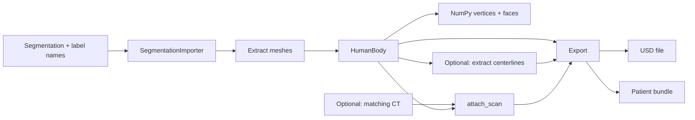
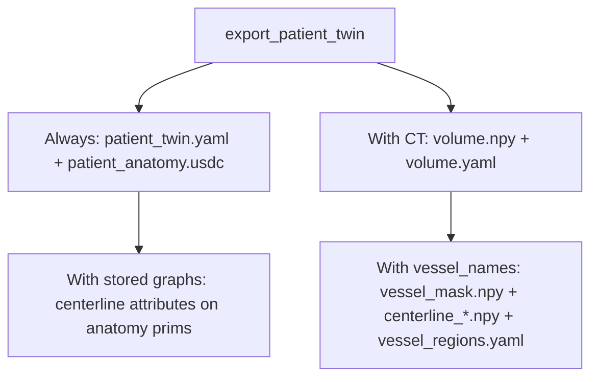

# Patient Digital Twin

Turn a 3D segmentation into named anatomy meshes. Optionally extract vessel or
airway centerlines, attach matching CT, and export USD or an i4h-workflows bundle.



## Install

Python 3.10+, from the repository root:

```bash
pip install -e './patient-digital-twin[pipeline]'
```

The `pipeline` extra supplies USD and skeleton-centerline dependencies for the segmentation and export
examples below. For mesh extraction alone, install `./patient-digital-twin`.

## 1. Load a segmentation and extract meshes

Use the bundled [s0011 CT and masks](examples/data/README.md). Fetch its CT with
Git LFS first (`git lfs pull`). The following Python snippets run in sequence from
the repository root and use new output directories.

```python
from pathlib import Path
from patient_digital_twin import HumanBody, SegmentationImporter

sample = Path("patient-digital-twin/examples/data/s0011")
importer = SegmentationImporter(sample / "segmentations", names=["aorta"])
body = HumanBody(importer.to_anatomy_collection())
aorta = body.anatomy.structures["aorta"]
vertices = aorta.body_vertices  # XYZ meters in the shared body frame.
faces = aorta.faces             # Triangle vertex indices.
```

To hide a mesh without deleting it, set `aorta.enabled = False`; set it to `True`
to restore it. YAML configuration policies are no longer supported.

For a single label volume, pass its matching ID-to-name dictionary instead.
Directory inputs use binary-mask filenames as names; `names` selects masks before
loading them. Masks may overlap: each structure keeps its own voxels, and bundle
navigation masks use the union of the selected vessels. No model inference is needed to use the supplied s0011 masks.

## 2. Optionally extract centerlines

Continue with the same `body`:

```python
body.extract_topology(names=["aorta"], spacing_m=0.0015)
graph = aorta.centerline
points, edges, radii = graph.points, graph.edges, graph.radii
```

Points and radii use the mesh's **local meters**; edges index the points.
Each mesh is voxelized at that spacing and skeletonized. Stored graphs
are included when exporting USD or a patient bundle. Skip this step for meshes only.

## 3. Optionally attach CT

Load the matching CT in Hounsfield units. It must share the segmentation's
physical coordinate frame; the affine carries its spacing, orientation, and origin.

```python
from patient_digital_twin.scan_volume import from_nifti

body.attach_scan(from_nifti(sample / "ct.nii.gz"))
```

`attach_scan` preserves the source array axes, spacing, orientation, origin, and
units for export, including oblique acquisitions. NIfTI uses its original IJK
array and RAS affine; unspecified spatial units are interpreted as millimeters.
The lower-level `attach_imaging` API accepts KJI arrays with an IJK-to-RAS-meter affine.

## 4. Export

Choose a standalone USD or a bundle with separate arrays:

```python
body.export_to_usd("patient.usdc")
# Or:
manifest = body.export_patient_twin("patient_bundle")
```

Both include stored centerlines and attached CT when present. The bundle directory
must be new. Export does not resample, reorient, or center the source scan.



For **i4h-workflows navigation**, attach CT and request the vessels explicitly:

```python
manifest = body.export_patient_twin(
    "navigation_bundle", vessel_names=["aorta"], ct_exterior=True
)
```

The exporter rasterizes the requested vessel meshes onto the source CT grid, placed
exactly as in the exported USD (including any registration passed to `attach_scan`),
and calculates navigation centerlines from that mask. Skeletonization uses a temporary LPS-ordered
view for consistent results; points are mapped back to the native scan frame.
For label imports this reproduces the
source labels voxel for voxel, apart from the stray islands the quality check removes. It does
not close the mask. This works without step 2; `ct_exterior=True` adds a CT-derived patient envelope.

### Quality check before export

`export_patient_twin` and `export_to_usd` first fix simple errors, in place, and the
bundle's `patient_twin.yaml` records them under `quality`:

- **Meshes** (`body.repair()`): faces on non-finite vertices, coincident vertices (common
  in STL files), degenerate faces, repeated faces and back-to-back pairs are removed, as
  are disconnected islands under 1% of a structure's faces (stray segmentation voxels; structure groups such as the costal cartilages keep all their parts).
  The export repairs what it writes; your `body` is left as it was (`body.repair()` repairs it in place).
- **Vessel gaps**: before skeletonizing the navigation centerline, a vessel piece within
  `max_gap_m` (default 5 mm) of a larger piece of the same circulation is joined to it by a
  tube as wide as the narrower vessel. In the s0011 example the left subclavian artery is
  labelled 3 mm short of the aorta, so without the bridge it would be a separate tree.
  Arteries never join veins, and the portal and pulmonary vessels never join the systemic
  ones. The bridge's centerline edges belong to the joining vessel; `vessel_mask.npy` keeps
  the unbridged labels.

```yaml
quality:
  mesh_repairs: {femur_right: {island_faces: 180, unreferenced_vertices: 92}}
  centerline_bridges:
  - {from: subclavian_artery_left, to: aorta, gap_mm: 3.0}
  centerline_components: 1
```

Pass `repair_body=False` to export the anatomy exactly as imported, or `max_gap_m=None`
to keep the repairs but skip bridging.

Schema-2 bundles preserve **scan array order** for CT and masks. Meshes and
navigation points/radii use the **scan physical frame and units**, declared in
`patient_twin.yaml`; `volume.yaml` records the full array-to-world affine and
source provenance. Read these fields rather than assuming ZYX, LPS, or millimeters.
Navigation centerlines support orthogonal grids, including oblique rotations;
sheared grids require explicit downstream resampling before centerline extraction.
Simulator placement belongs to the consuming workflow. HU → μ conversion belongs
to sensor-simulation, with `linear` (default) and `interventional` presets.

### Vessel regions and stiffness

Each vessel in `vessel_names` becomes its own physics region, so a simulator can
give the aorta, the iliac arteries and a femoral artery different wall stiffness.
The navigation centerline stays one connected graph across vessel junctions; the
bundle adds which vessel each edge belongs to:

| File | Content |
| --- | --- |
| `centerline_regions.npy` | int32 region ID for each row of `centerline_edges.npy` |
| `vessel_regions.yaml` | Region ID → vessel name, and each vessel's wall Young's modulus |

```yaml
schema_version: 1
default: unassigned
branches: {0: aorta, 1: iliac_artery_right, 2: iliac_artery_left}
young_modulus_kpa: {aorta: 400.0, iliac_artery_right: 400.0, iliac_artery_left: 400.0}
```

The exporter rasterizes each vessel separately; where two overlap, the vessel listed
first in `vessel_names` keeps the voxel. Every centerline point lies on one voxel, and
an edge belongs to the vessel of its first point. The YAML file header cites the
sources it used. `write_artifacts(scan, output, vessel_mask=labels, vessel_names=names)`
writes the same files from a label volume in which value `i` is `names[i - 1]`.

`vessel_regions.yaml` is an i4h-physics-simulation vessel region sidecar: region IDs
are the centreline branch IDs, and a `rod_pbd_material` with
`reference_young_modulus_kpa` starts each region's bend and twist multipliers at
E / reference (see `numerical_sim/docs/vessel-regions.md` there). The moduli are
literature defaults, not patient measurements:

| E (kPa) | Vessels | Source |
| --- | --- | --- |
| 400 | Aorta (and its segments), brachiocephalic trunk, common carotid, subclavian, renal, common iliac (`iliac_artery`) | Wang & Parker 2004, Table 1 |
| 800 | Internal and external carotid, vertebral, external iliac, femoral, popliteal; any other artery | Wang & Parker 2004, Table 1 |
| 1600 | Internal iliac | Wang & Parker 2004, Table 1 |
| 21 / 23 / 40 / 38 / 66 | Superior vena cava / inferior vena cava / brachiocephalic vein / iliac vein / femoral vein | Derived from Müller & Toro 2014, Table 8 |
| 50 | Portal and splenic vein; any other vein (name contains `vein` or `vena`) | Derived from Müller & Toro 2014 |
| 260 | Pulmonary artery and pulmonary vein | Derived from Qureshi et al. 2014 |

Arterial values describe young adults at about 100 mmHg. Venous values are derived
from published wave speeds as E = 2ρc₀²R/h with an assumed wall h = 0.1R, at about
5 mmHg; veins stiffen sharply at higher pressure. Wall stiffness also rises with age:
an aortic wave speed 1.5 times higher means about 2.25 times the modulus.

To support another segmentation model's vessel, add a row to
`patient_digital_twin/vessels.py`. Its names join the anatomy catalog, so importers
keep the label (for example "Left femoral artery" becomes `femoral_artery_left`):

```python
from patient_digital_twin.vessels import vessel_stiffness

assert vessel_stiffness("femoral_artery_left").young_modulus_kpa == 800.0
```

## DICOM and reproducible volume artifacts

Install `./patient-digital-twin[dicom]` to read regular single-frame DICOM CT series.
The CLI accepts a DICOM directory (and `--series-uid` when it contains multiple
series), or an existing `volume.yaml`, in place of the NIfTI input below.
DICOM CLI export keeps the acquisition grid in LPS millimeters and KJI array order.

The small `scan_volume` helper is implemented in sensor-simulation (`xray_simulator.scan_volume`) and re-exported here. Use it
explicitly when a consumer needs a chosen frame, units, axes, or voxel spacing.
This separate example requires your own regular CT series in `dicom/` and the
`dicom` extra; s0011 is supplied as NIfTI:

```python
from patient_digital_twin.scan_volume import Conversion, export_ct, replay

recipe = export_ct("dicom/", "ct_artifact", options=Conversion(
    world_frame="RAS", world_unit="m", origin="dicom", array_axes="kji",
    spacing_ijk_mm=None,  # Preserve spacing; a tuple requests resampling.
))
replay(recipe, "dicom/", "reproduced_ct")
```

This writes `volume.npy` in HU plus one `volume.yaml` containing conversion options,
source file hashes, affines, units, output hash, and implementation versions.
Replay verifies those inputs and versions. Irregular slices and enhanced multi-frame
DICOM require an explicit conversion before using this regular-grid reader.

## Start from CT or generate a patient

The CLI runs **NV-Segment** on an input image or **NV-Generate** to produce paired
CT and labels. Both are optional; install only the backend you use:

```bash
pip install -e './patient-digital-twin[pipeline,nvsegment]'
# Or:
pip install -e './patient-digital-twin[pipeline,nvgenerate]'
```

These extras install inference dependencies, not model source or weights. Provide
an upstream checkout and its model assets; use a CUDA-compatible PyTorch build.
Inference runs through Python imports in the current process by default. See the upstream
[NV-Segment](https://github.com/NVIDIA-Medtech/NV-Segment-CTMR) and
[NV-Generate](https://github.com/NVIDIA-Medtech/NV-Generate-CTMR) setup guides.
As upstream, NV-Generate reads its `datasets/` files from `$MONAI_DATA_DIRECTORY`; set it
to reuse downloaded data, otherwise each run downloads the datasets to a temporary directory.

Example: segment the aorta from `s0011/ct.nii.gz` in the
[TotalSegmentator small dataset v201](https://zenodo.org/records/10047263), using
NV-Segment rather than the supplied masks:

```bash
python -m patient_digital_twin \
  --source nvsegment --input patient-digital-twin/examples/data/s0011/ct.nii.gz \
  --bundle-root /path/to/NV-Segment-CTMR/NV-Segment-CTMR \
  --classes aorta \
  --format bundle --output ./output/s0011_aorta

python -m patient_digital_twin \
  --source nvgenerate --source-root /path/to/NV-Generate-CTMR \
  --classes aorta liver --format usd --output ./output/generated.usdc
```

The import API uses the same backends (requires the indicated model checkout and weights):

```python
from patient_digital_twin import NVSegmentImporter, NVGenerateImporter

anatomy = NVSegmentImporter(
    sample / "ct.nii.gz", bundle_root="/path/to/NV-Segment-CTMR/NV-Segment-CTMR"
).to_anatomy_collection(names=["aorta"])

# Alternative: generate paired anatomy and CT.
generator = NVGenerateImporter(source_root="/path/to/NV-Generate-CTMR")
anatomy = generator.to_anatomy_collection(names=["aorta"])
# Matching source CT: generator.ct_scan (attach with body.attach_scan).
```

An explicit `--python /model/env/bin/python` (or `python_executable=` in Python)
opts into a separate process. Use it when dependencies need a different environment
or other application threads depend on the working directory: upstream inference
uses relative paths, so in-process calls temporarily change it and are serialized.

Use new output paths. Bundle patient IDs are derived automatically from the input
folder (`geometry` for generated anatomy); no `--patient-id` option is needed.
The CLI extracts missing vessel centerlines automatically.
NV-Segment accepts 3D `.nii`/`.nii.gz`, DICOM CT, or `volume.yaml`;
`--modality MR` supports geometry-only NIfTI USD.
Bundle output requires CT and at least one vessel. Run
`python -m patient_digital_twin --help` for options.

In an installed i4h-workflows checkout:

```bash
./run.sh endoluminal_navigation --mode validate_fluoroscopy --episodes 1 \
  --patient-twin /path/to/output/s0011_aorta/patient_twin.yaml \
  --record verify.hdf5
```

Add `--headless` when no display is available.

## More detail

- [Package architecture](patient_digital_twin/README.md)
- [USD layout and coordinate transforms](docs/usd.md)
- [Example scripts and viewer](examples/README.md)
- [Standalone CT and centerline artifacts](examples/README.md#ct-and-centerline-arrays-only)
