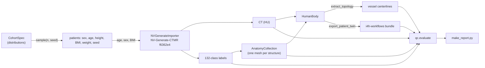

# Generate patient cohorts with NV-Generate-CTMR

This tutorial generates a cohort of synthetic patients with chosen characteristics,
such as sex, age, and BMI, turns each generated CT into a patient digital twin, and
quality-checks every twin. It uses NV-Generate-CTMR's body-mask model, which is
conditioned on patient demographics, through `patient_digital_twin.NVGenerateImporter`.

The [report](REPORT.md) shows the results for a 500-patient cohort.

| File | Purpose |
| --- | --- |
| [`cohort.py`](cohort.py) | Distributions (`Binomial`, `Normal`, `LogNormal`, `Histogram`, `Conditional`, `Derived`, ...) and `CohortSpec` |
| [`presets.py`](presets.py) | Literature-based cohort specifications: `ct_patients`, `us_adults`, `nv_generate_training` |
| [`generate_cohort.py`](generate_cohort.py) | Samples a cohort, then generates, builds, exports, and measures every patient |
| [`qc.py`](qc.py) | Quality metrics for one patient: CT, labels, meshes, centerlines, bundle |
| [`bmi_sweep.py`](bmi_sweep.py) | Counterfactual sweep: the same seeds at several BMIs |
| [`make_report.py`](make_report.py) | Verdicts, tables, statistics, and figures for the report |



## How patient characteristics reach the generated CT

NV-Generate-CTMR's `rflow-ct` pipeline has two stages
([NV-Generate-Body, Zhao et al. 2026](https://arxiv.org/abs/2610.24153);
[MAISI-v2](https://arxiv.org/abs/2508.05772)):

1. **Body mask.** A rectified-flow latent diffusion model
   (`DiffusionModelUNetMaisiAdaGN`, `models/mask_generation_diffusion_unet_v2.pt`)
   generates a 256³ label map (132 anatomical classes plus a body envelope) at the
   requested voxel spacing, in 100 steps with classifier-free guidance 2.0. It is
   conditioned on 19 numbers: 9 organ sizes, 5 tumor sizes, and 5 demographics.
2. **CT image.** The CT diffusion model and its ControlNet synthesize the image from
   that mask in 30 steps. The mask is the label volume returned with the CT.

Demographics enter only the first stage. Upstream
[`scripts/sample.py`](https://github.com/NVIDIA-Medtech/NV-Generate-CTMR/blob/f6362e4d0bc572e387f35b522369f0f15b27dade/scripts/sample.py)
(`prepare_anatomy_size_condition`) fills conditioning slots 14-18:

| Slot | Characteristic | Input (`controllable_demographics`) | Normalized value | Training data |
| --- | --- | --- | --- | --- |
| 14 | age | years | age / 120 | 930 cases, 64.1 ± 12.0, range 19-87 |
| 15 | sex | `"M"` or `"F"` | M = 1, F = 0 | 1,988 cases, 60.2% male |
| 16 | weight | kg | weight / 200 | 666 cases, 73.4 ± 17.1, range 22-144 |
| 17 | BMI | kg/m² | BMI / 75 | 1,020 cases, 29.3 ± 6.3, range 18-63 |
| 18 | height | cm | height / 200 | not trained |

An omitted characteristic is set to -1 ("unknown"), which the model learned as the
unconditioned token. Training counts are from Table 5 of the NV-Generate-Body paper
(8,571 training cases in total); the ranges are also hard-coded in upstream
[`scripts/sample_mask.py`](https://github.com/NVIDIA-Medtech/NV-Generate-CTMR/blob/f6362e4d0bc572e387f35b522369f0f15b27dade/scripts/sample_mask.py),
which warns when a value falls outside them. Upstream rules that matter:

- **BMI or weight, not both.** They come from almost disjoint training cases (they
  co-occur in under 0.4%). The upstream skills prefer BMI.
- **No height.** The slot exists but has no training data. Height can describe a
  virtual patient (and, with BMI, its weight), but it does not change the anatomy.
- **Few organ-size conditions.** At most one organ or tumor size may be set, and
  upstream warns that a size plus three or more demographics is out of distribution.
  This tutorial conditions on demographics only.
- **Fidelity.** The paper reports Spearman ρ = 0.78 between the requested BMI and
  the generated body volume (guidance 2.0), and prostate presence in 100% of male and
  0% of female masks. It does not evaluate age.
- **Field of view.** The mask is always generated on a 256³ grid at the requested
  spacing, so the anatomy spans 256 × spacing; a larger `output_size` only pads. The
  upstream default, 1.5 × 1.5 × 2.0 mm, is 384 × 384 × 512 mm and cuts off the lung
  apices. This tutorial uses 1.9 × 1.9 × 2.5 mm (486 × 486 × 640 mm): lung apices to
  pelvis, close to a 500 mm clinical scan field of view. Very wide patients still
  touch the lateral edge, as they do in clinical CT.

The patient-digital-twin package passes these settings through:

```python
from patient_digital_twin import HumanBody, NVGenerateImporter

generator = NVGenerateImporter(
    source_root="/path/to/NV-Generate-CTMR",
    python_executable="/path/to/NV-Generate-CTMR/.venv/bin/python",
    demographics={"age": 62, "sex": "F", "bmi": 31.5},  # bmi or weight; no height
    seed=7, spacing=(1.9, 1.9, 2.5), output_size=(256, 256, 256),
)
body = HumanBody(generator.to_anatomy_collection(names=["aorta", "liver"]))
body.attach_scan(generator.ct_scan)  # generator.label_image holds the paired labels
```

or, from the command line:

```bash
python -m patient_digital_twin --source nvgenerate \
  --source-root /path/to/NV-Generate-CTMR --python /path/to/NV-Generate-CTMR/.venv/bin/python \
  --demographics age=62 sex=F bmi=31.5 --seed 7 \
  --classes aorta liver --format usd --output ./output/patient_bmi31.usdc
```

`NVGenerateImporter` is tested against NV-Generate-CTMR commit `f6362e4`
(`patient_digital_twin.importers.NV_GENERATE_COMMIT`). At that commit, upstream
`scripts.inference` still fails on the v2 mask checkpoint (`'float' object has no
attribute 'to'`); the importer converts the checkpoint's `scale_factor` while it runs
inference, so use the importer rather than the upstream command line.

## Setup

You need a CUDA GPU (a patient peaks at about 10 GB of GPU memory and 10 GB of RAM)
and about 110 MB of disk per patient. NV-Generate-CTMR runs in its own environment:

```bash
git clone https://github.com/NVIDIA-Medtech/NV-Generate-CTMR
cd NV-Generate-CTMR
git checkout f6362e4d0bc572e387f35b522369f0f15b27dade
python -m venv .venv
.venv/bin/pip install -r requirements.txt  # Use a PyTorch build for your CUDA version.
.venv/bin/python -m scripts.download_model_data --version rflow-ct --root_dir ./data --model_only
cd ..
```

The last command downloads the five `rflow-ct` checkpoints (5.0 GB) into `models/`.
In the patient-digital-twin environment, from the repository root:

```bash
pip install -e './patient-digital-twin[pipeline]' matplotlib
```

## Describe a cohort

A `CohortSpec` maps characteristic names to distributions. Characteristics are drawn
in order, so later ones can depend on earlier ones; `conditioning` names those passed
to NV-Generate:

```python
import sys

sys.path.insert(0, "patient-digital-twin/tutorials/cohort_generation")
from cohort import Binomial, CohortSpec, Conditional, Derived, LogNormal, Normal, Uniform, weight_from_bmi

spec = CohortSpec(
    {
        "sex": Binomial(p=0.5),  # Binomial(n, 0.5) males in a cohort of n
        "age": Uniform(40, 70),
        "height": Conditional("sex", {"M": Normal(175.3, 7.6, 152, 198), "F": Normal(161.3, 7.1, 140, 183)}),
        "bmi": LogNormal(median=42, sigma=0.12, low=35, high=60),  # bariatric surgery candidates
        "weight": Derived(weight_from_bmi, "BMI x (height / 100)^2"),
    },
    conditioning=("age", "sex", "bmi"),
)
patients = spec.sample(100, seed=1)  # [{"id": "P0000", "sex": ..., "seed": ...}, ...]
```

| Distribution | Use for | Parameters |
| --- | --- | --- |
| `Binomial(p, outcomes=("M", "F"))` | sex | probability of the first outcome |
| `Normal(mean, sd, low, high)` | height, age | Gaussian, optionally truncated |
| `LogNormal(median, sigma, low, high, shift)` | BMI, weight (right-skewed) | `sigma` is the SD of ln(value - shift) |
| `Uniform(low, high)` | ranges without a known shape | |
| `Histogram(edges, weights)` | census age bands | piecewise uniform |
| `Categorical(values, weights)`, `Fixed(value)` | discrete choices, constants | |
| `Conditional(on, {value: distribution})` | sex-specific height or BMI | earlier characteristic |
| `Derived(function, description)` | weight from BMI and height | earlier characteristics |

Truncation is exact (inverse-CDF sampling), so values never pile up at a bound.
Two helpers fit a log-normal to published figures: `lognormal_from_percentiles(20.8, 28.5, 41.0)`
matches a 5th, 50th, and 95th percentile (here NHANES men's BMI), and
`lognormal_from_prevalence(30, 0.403, 40, 0.094)` matches the shares above two thresholds
(here adult obesity and severe obesity).
Keep conditioned characteristics inside the model's training ranges
(`cohort.TRAINING_RANGE`). To use your own specification with `generate_cohort.py`,
add a function returning it to `PRESETS` in [`presets.py`](presets.py).

## Choosing distributions

The 500-patient report uses the `ct_patients` preset: adults as they undergo CT. Sex
and age come from 2,005,459 adult CT examinations at 151 institutions, 81% of them in
the US ([Smith-Bindman et al. 2019](https://doi.org/10.1136/bmj.k4931), Table 1). No
CT cohort reports height and BMI by sex, so those come from the US reference survey
([NHANES 2015-2018, Fryar et al. 2021](https://stacks.cdc.gov/view/cdc/100478)).
Conditioned values stay inside the model's training ranges.

| Characteristic | Distribution | Parameters | Source | Check against the literature |
| --- | --- | --- | --- | --- |
| sex | Binomial | P(male) = 0.473 | Smith-Bindman 2019: 1,056,929 of 2,005,459 examinations in women | |
| age (years) | Histogram of 10-year bands, sampled 19-87 | 18-29: 9.0%, 30-39: 8.9%, 40-49: 12.5%, 50-59: 19.2%, 60-69: 21.9%, 70-79: 16.8%, 80+: 11.7% | Smith-Bindman 2019 | |
| height (cm) | Normal by sex, truncated at ±3 SD | men 175.3 ± 7.48, women 161.3 ± 6.90 | Fryar 2021, Tables 9 and 11: mean; SD from the 5th-95th percentile spread | percentiles are symmetric about the median |
| BMI (kg/m²) | Three-parameter log-normal by sex, truncated 18-63 | men median 28.5, log-SD 0.295, shift 8.45; women median 28.4, log-SD 0.378, shift 9.61 | Fryar 2021, Tables 14 and 15: 5th, 50th, and 95th percentiles | implied means 29.4 (men) and 29.8 (women) equal the reported means; implied obesity (BMI ≥ 30) 40.3% and 41.4%, severe obesity (≥ 40) 6.2% and 10.2%, against 39.2%, 41.3%, 6.7%, and 12.1% measured in 2021-2023 ([Emmerich et al. 2024](https://www.cdc.gov/nchs/products/databriefs/db508.htm)) |
| weight (kg) | Derived: BMI × (height / 100)² | | | NHANES means 90.6 (men) and 77.5 (women) |

Why these shapes and ranges:

- **Sex** has two outcomes, so each patient is one Bernoulli trial and a cohort's
  male count is Binomial(n, 0.473).
- **Age** of CT patients is older than the population: CT use rises with age. The
  histogram reproduces the examination counts; ages are drawn uniformly within a band.
  The 18-29 band starts at 19 and the 80+ band ends at 87, the model's training range.
- **Height** within each sex is close to normal (the NHANES percentiles are symmetric).
  It does not condition the model; with BMI it gives each virtual patient a weight.
- **BMI** is right-skewed ([Penman and Johnson 2006](https://www.cdc.gov/pcd/issues/2006/jul/05_0232.htm)).
  A two-parameter log-normal fitted to the obesity prevalences puts 10-12% of patients
  below the 5th percentile; the three-parameter form (`lognormal_from_percentiles`)
  matches all three percentiles and, as an independent check, the reported means and
  current obesity prevalence. Truncating to 18-63 removes 0.6% of men and 1.7% of women
  (below 18) and under 0.3% above 63.
- **Weight** is derived, so height, weight, and BMI stay consistent. NV-Generate is
  conditioned on BMI, which upstream prefers over weight.
- BMI and height do not depend on age here, although NHANES BMI is lower at 20-29 and
  80+; use `Conditional("age", ...)` with age-band distributions if that matters.

Other presets: `us_adults` takes sex (P(male) = 0.484) and age by sex from the 2020
Census (table P12, adults 20+), with the same height and BMI; `nv_generate_training`
reproduces the model's training demographics (60.2% male, age 64.1 ± 12.0,
BMI 29.3 ± 6.3) for an in-distribution cohort.

## Run a cohort

From `patient-digital-twin/`, first check the sampled cohort without generating it:

```bash
python tutorials/cohort_generation/generate_cohort.py --output ~/cohort --count 500 --sample-only
```

Then generate it. Each worker runs one patient at a time; three workers share one
96 GB GPU well. `HF_HUB_OFFLINE=1` stops upstream's per-run Hugging Face download
check once the weights are on disk:

```bash
HF_HUB_OFFLINE=1 python tutorials/cohort_generation/generate_cohort.py \
  --output ~/cohort --count 500 --workers 3 \
  --source-root ~/NV-Generate-CTMR --python ~/NV-Generate-CTMR/.venv/bin/python
```

Rerun the same command to resume after an interruption: patients with a
`record.json` are skipped. Every patient folder holds:

| Path | Content |
| --- | --- |
| `ct.nii.gz`, `labels.nii.gz` | generated CT (HU) and NV-Generate labels (`configs/label_dict.json` IDs) |
| `twin/` | i4h-workflows bundle: `patient_twin.yaml`, `patient_anatomy.usdc` (meshes and CT skin envelope), `volume.npy`, aorta `vessel_mask.npy` and `centerline_*.npy` |
| `record.json` | characteristics, timings, and every quality metric |
| `pipeline.log` | upstream inference output and any traceback |

Optionally, run the counterfactual BMI sweep, then build the figures and tables:

```bash
HF_HUB_OFFLINE=1 python tutorials/cohort_generation/bmi_sweep.py --output ~/sweep --workers 3 \
  --source-root ~/NV-Generate-CTMR --python ~/NV-Generate-CTMR/.venv/bin/python
python tutorials/cohort_generation/make_report.py --cohort ~/cohort --sweep ~/sweep
```

`make_report.py` writes `figures/` and `results/` next to this README. Rendering the
twins needs VTK with off-screen OpenGL (EGL on a GPU machine, or OSMesa).

## Quality checks

`qc.py` measures; `make_report.py` judges, so thresholds can change without
regenerating. A patient is **twin-ready** when all of these hold:

| Check | Passes when |
| --- | --- |
| `generated` | NV-Generate produced a CT and labels, and every pipeline step ran |
| `ct_intensity` | the median HU of liver, spleen, pancreas, kidneys, and lungs lies within NV-Generate's own acceptance range (`configs/image_median_statistics_ct.json`, as in upstream `quality_check.py`) |
| `core_present` | all 16 core structures are labeled: aorta, heart, five lung lobes, liver, spleen, pancreas, stomach, both kidneys, inferior vena cava, portal and splenic vein, urinary bladder |
| `core_complete` | no core structure touches the scan boundary |
| `core_connected` | each core structure except the merged portal/splenic vein label has at least 99% of its voxels in one 26-connected piece |
| `core_meshes_closed` | every core mesh is a closed 2-manifold, as `extract_topology` and bundle vessel masks require |
| `aorta_centerline` | the aorta centerline is one connected graph |
| `bundle` | the bundle re-reads: every USD anatomy prim, a CT-grid vessel mask, a navigation centerline |

Two findings are reported but not required: `body_in_fov` (the body is not cut at
the sides; wide patients exceed the field of view, as in clinical CT) and
`portal_vein_connected` (NV-Generate's merged portal and splenic vein label is
rarely one piece, which would otherwise fail almost every patient). The report also
measures how well the generated anatomy follows the conditioned
characteristics: body volume, L3 body and adipose area (-190 to -30 HU), organ
volumes by sex, and aortic diameter against age.

## Limitations

- The twins are synthetic. NV-Generate-CTMR learned from 8,571 CT scans, of which
  only a minority carried demographics; generated anatomy is plausible, not
  validated against the patients it is meant to represent.
- Height does not reach the model, so two patients with the same BMI but different
  heights get anatomy of the same size distribution.
- The quality checks are engineering checks (presence, completeness, topology,
  intensity ranges), not a clinical review of anatomical correctness.
