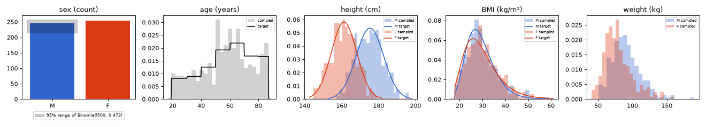
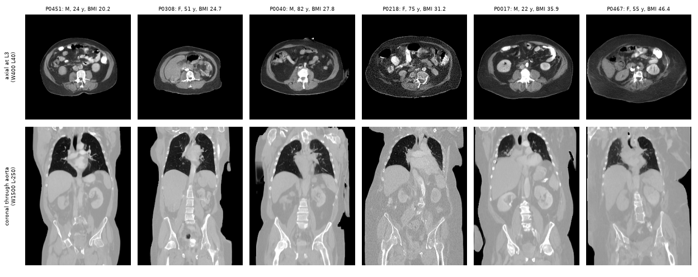
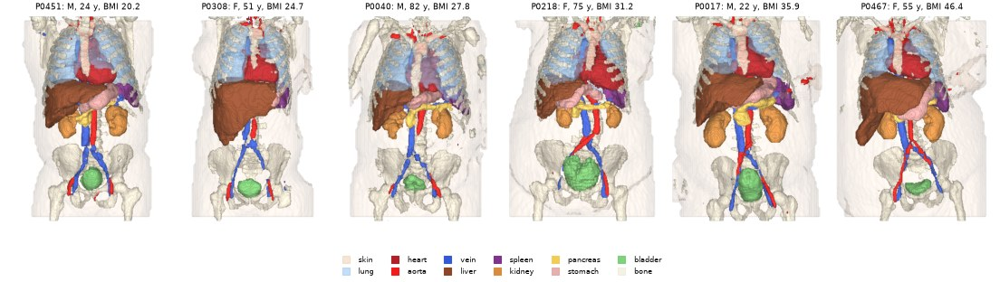
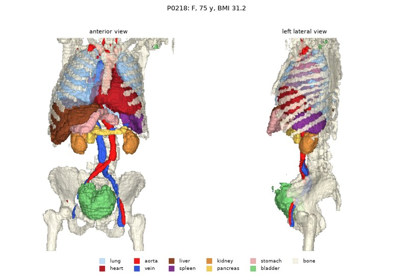
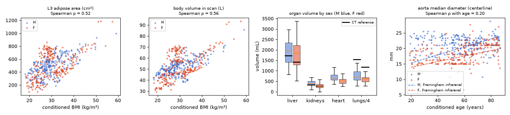
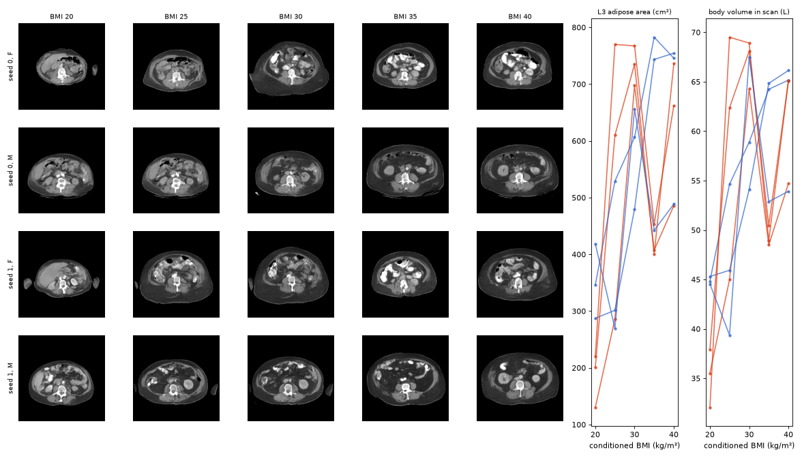
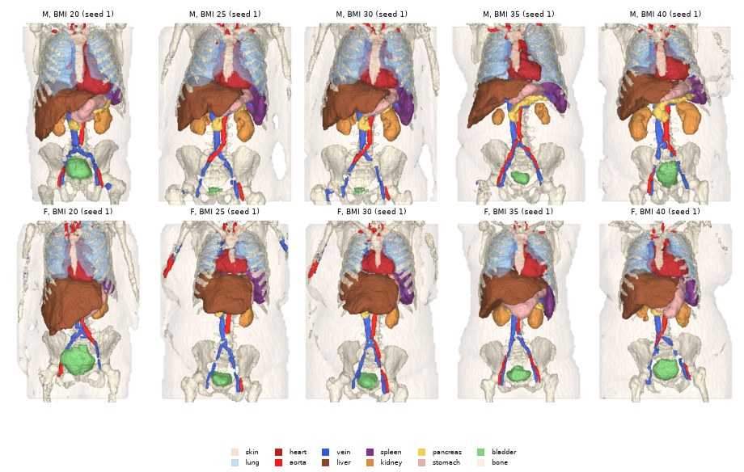

# 500 synthetic CT patients as digital twins

Results of the [cohort generation tutorial](README.md), run on 2026-11-19: 500 patients
sampled from the `ct_patients` preset, each generated by NV-Generate-CTMR conditioned on its
age, sex, and BMI, built into a patient digital twin, and quality-checked. Every number below
comes from [`results/summary.json`](results/summary.json),
[`results/patients.csv`](results/patients.csv) (one row per patient), and
[`results/bmi_sweep.csv`](results/bmi_sweep.csv), written by [`make_report.py`](make_report.py).
The patient data (CTs, labels, and bundles, 50 GB) is not in the repository.

## Summary

- **Every patient ran end to end.** All 500 CTs were generated and went through the whole
  pipeline: meshing a median of 112 structures (1.3 million triangles) per patient, vessel
  centerlines, bundle export, and quality metrics. The run took 2.9 hours on one GPU with
  three patients in parallel, 62 s per patient, and 92 MB per bundle.
- **217 of 500 twins (43%) pass every check.** Mesh topology is the largest blocker: 191
  patients have a core organ mesh that is not a closed surface. All 2,744 non-closed meshes
  in the cohort come from one defect: scikit-image's marching cubes emits back-to-back
  triangle pairs. Removing both triangles of each pair closes every one of them. With that
  fix an estimated 350 of 500 patients (70%) would pass, leaving fragmented labels, split
  aorta centerlines, and a few cut-off lung apices.
- **BMI shapes the body, but more loosely than in real patients.** The requested BMI
  correlates with body volume (Spearman ρ = 0.56) and with adipose tissue area at L3
  (ρ = 0.52). In real CT, BMI correlates with L3 fat area at 0.82 to 0.85. Median L3 adipose
  area is flat between BMI 25 and 40 (512 to 553 cm²), and 34 of 42 patients with BMI ≥ 40
  are cut at the sides by the 486 mm field of view.
- **Sex conditioning works; age conditioning is weak.**
  - Men get larger kidneys (1.47×), heart (1.29×), lungs (1.24×), and aorta (1.16×), and an
    organ-sized prostate in 84% (median 25 mL). Only 1 of 254 women gets one.
  - Aortic diameter barely rises with age (ρ = 0.20 overall, none in men), against
    1-2 mm per decade in the Framingham CT study.
- **Organ sizes are biased.** Generated lungs are half of inspiratory CT volumes, spleens
  are 1.4-1.7× larger, and livers 1.1-1.3× larger than CT reference values. Kidneys and
  aortic diameter are within 25%.
- **The label maps are noisy.**
  - The merged portal/splenic vein label is fragmented in 91% of patients.
  - Spurious brain labels appear in 35% of these torso scans, and prostate fragments in 44%
    of women.
  - A median of 58% of a patient's structures come out in more than one piece.
- **Three fixes would help most**; see [Findings and recommendations](#findings-and-recommendations):
  - remove back-to-back triangle pairs in `mask_to_mesh`;
  - let `extract_topology` keep the centerlines that succeed;
  - fix upstream NV-Generate-CTMR's crash on its own v2 checkpoint, which
    `NVGenerateImporter` still works around.

## Protocol

| Setting | Value |
| --- | --- |
| Generator | NV-Generate-CTMR [`f6362e4`](https://github.com/NVIDIA-Medtech/NV-Generate-CTMR/tree/f6362e4d0bc572e387f35b522369f0f15b27dade) (upstream main, 2026-10-20), `rflow-ct` with the v2 body-mask model |
| Checkpoints (SHA-256 prefix; identical to Hugging Face `nvidia/NV-Generate-CT` main) | `autoencoder_v1` 1f8a7a056d0e, `diff_unet_3d_rflow-ct` cfc1ec59782f, `controlnet_3d_rflow-ct` 2f16d7a6b4d6, `mask_generation_autoencoder` 539175f6ede3, `mask_generation_diffusion_unet_v2` d88d514bfc47 |
| Conditioning | each patient's age, sex, and BMI; no organ-size condition |
| Sampling | mask: 100 rectified-flow steps, guidance 2.0; image: 30 steps (upstream defaults) |
| Grid | 256³ voxels at 1.9 × 1.9 × 2.5 mm (486 × 486 × 640 mm) |
| Seeds | cohort seed 20261119; one generation seed per patient (`results/patients.csv`) |
| Twin pipeline | `NVGenerateImporter` meshes every labeled catalog structure; `HumanBody.attach_scan`; `extract_topology` per vessel at 1.5 mm; `export_patient_twin(vessel_names=["aorta"], ct_exterior=True)` |
| Code | this branch at commit `87490e2` (a frozen copy ran the cohort); `make_report.py` from the commit that adds this report |
| Software | generation: PyTorch 2.13.0 (CUDA 13.0), MONAI 1.6.0; twins: NumPy 2.5.3, SciPy 1.18.1, scikit-image 0.26.0, VTK 9.7.1, OpenUSD 26.08 |
| Hardware | 1 × NVIDIA RTX PRO 6000 Blackwell (96 GB), AMD Ryzen Threadripper PRO 7965WX (24 cores), 62 GB RAM |

Median time per patient, with three in parallel: 51.8 s to generate and mesh, 0.7 s for
centerlines, 3.1 s for the bundle, and 5.9 s for quality metrics. That is 62.2 s in total,
8.7 compute-hours, or 2.9 hours of wall time.

## Cohort

The table lists each characteristic as set (distribution and source), the range it was
sampled in, and the realized cohort. Only age, sex, and BMI condition NV-Generate-CTMR;
height and weight describe the virtual patients.
[Choosing distributions](README.md#choosing-distributions) in the tutorial explains each choice.

| Characteristic | Distribution as set | Conditions NV-Generate | Model training range | Sampled range | Sampled mean ± SD | By sex | Source |
| --- | --- | --- | --- | --- | --- | --- | --- |
| sex | Binomial, P(M) = 0.473 | yes | | F 254 (50.8%), M 246 (49.2%) | | | Smith-Bindman 2019: 2,005,459 adult CT examinations |
| age (years) | Histogram of 10-year bands (CT examinations by age), 19-87 | yes | 19-87 | 19.0-86.8 | 57.0 ± 17.9 | M 57.1 ± 17.6; F 57.0 ± 18.2 | Smith-Bindman 2019 |
| height (cm) | Normal by sex: M 175.3 ± 7.48 in [152.9, 197.7]; F 161.3 ± 6.90 in [140.6, 182.0] | no | | 144.6-196.2 | 167.8 ± 9.9 | M 174.9 ± 7.2; F 161.0 ± 7.0 | NHANES 2015-2018 (Fryar 2021) |
| BMI (kg/m²) | Three-parameter log-normal by sex: M median 28.5, log-SD 0.295, shift 8.45; F median 28.4, log-SD 0.378, shift 9.61; in [18, 63] | yes | 18-63 | 18.1-59.0 | 30.1 ± 6.8 | M 29.8 ± 6.6; F 30.3 ± 7.1 | NHANES 2015-2018 (Fryar 2021) |
| weight (kg) | Derived: BMI × (height / 100)² | no | 22-144 | 40.7-190.1 | 84.9 ± 21.7 | M 91.1 ± 21.3; F 78.9 ± 20.3 | NHANES means: M 90.6, F 77.5 |

The realized cohort matches its sources:

- The male count, 246, lies inside the 95% range of Binomial(500, 0.473), which is 215-258.
- Mean age is 57.0 years, against 58.1 for the target histogram.
- Mean weight is 91.1 kg for men and 78.9 kg for women, against 90.6 and 77.5 in NHANES.
- 42.8% of patients are obese (BMI ≥ 30), against 40.3% of US adults in 2021-2023.
- No conditioned value falls outside the model's training ranges.



*Sampled sex, age, height, BMI, and weight. Lines show the target densities; the shaded
bar on the sex panel is the 95% range of Binomial(500, 0.473).*

## Sample scans



*Six patients that pass every check, spread over the BMI range (20 to 46). Top: axial
slice at the center of L3 (soft-tissue window). Bottom: coronal slice through the aorta
(wide window). The field of view runs from the lung apices to the hips.*

## Sample twins



*The same six patients, rendered from their exported bundles (`patient_anatomy.usdc`) at
one scale. Shown: the CT skin envelope, lungs, heart, aorta and arteries, veins, liver,
spleen, kidneys, pancreas, stomach, bladder, and skeleton. Body width grows with BMI from
left to right.*



*Patient P0218 (woman, 75 years, BMI 31.2) without the skin envelope. Each structure is a
separate mesh with its own prim in the bundle. The aorta also carries a navigation
centerline and a vessel mask on the CT grid.*

## Quality checks

A patient is twin-ready when all eight checks pass. The tutorial's
[quality checks](README.md#quality-checks) define the 16 core structures. The last two rows
are reported but not required.

| Check | Passes when | Passed |
| --- | --- | --- |
| `generated` | NV-Generate produced a CT and labels, and every pipeline step ran | 500 (100%) |
| `ct_intensity` | median HU of liver, spleen, pancreas, kidneys, lungs, and any brain label within NV-Generate's own acceptance ranges | 483 (96.6%) |
| `core_present` | all 16 core structures labeled | 493 (98.6%) |
| `core_complete` | no core structure's largest piece touches the scan boundary | 485 (97.0%) |
| `core_connected` | each core structure except the merged portal/splenic vein label has at least 99% of its voxels in one piece | 392 (78.4%) |
| `core_meshes_closed` | every core mesh is a closed 2-manifold | 309 (61.8%) |
| `aorta_centerline` | the aorta centerline is one connected graph | 450 (90.0%) |
| `bundle` | the bundle re-reads: all USD anatomy prims, CT-grid vessel mask, navigation centerline | 482 (96.4%) |
| **twin-ready** | **all of the above** | **217 (43.4%)** |
| `body_in_fov` | body not cut at the left, right, anterior, or posterior boundary | 375 (75.0%) |
| `portal_vein_connected` | the portal/splenic vein label has at least 99% of its voxels in one piece | 45 (9.0%) |

Failures by core structure. A patient can appear in several cells, and the counts are
patients:

| Structure | Missing | Cut by the boundary | Fragmented (> 1% outside the largest piece) | Mesh not closed | Stray fragment at the boundary |
| --- | --- | --- | --- | --- | --- |
| lungs, upper lobe right / left | | 5 / 13 | | 54 / 15 | |
| lungs, lower lobe right / left; middle lobe | | | 7 (middle) | 32 / 22; 18 | |
| heart | | | 17 | 37 | 37 |
| aorta | | | 2 | 18 | |
| liver | | | | 16 | |
| urinary bladder | 1 | 1 | 87 | 18 | 28 |
| kidney right | 5 | | | 1 | |
| inferior vena cava | | | 4 | 2 | |
| pancreas; stomach; spleen | 1 (spleen) | | 1 (pancreas) | 3; 2 | |
| portal/splenic vein (reported separately) | | | 455 | 3 | 1 |

One check was changed after inspecting the results. At first `core_complete` failed a patient
whenever any voxel of a core label touched the boundary, which failed 73 patients. In 58 of
them only a small stray piece of the heart or bladder label touched the boundary; the organ
itself sat well inside the scan. The check now tests each structure's largest piece, and
stray fragments are counted separately (last column). Only lung apices (18 lobes in
14 patients) and one bladder are truly cut off by the field of view.

### Mesh topology

`mask_to_mesh` (scikit-image marching cubes) produced 2,744 meshes that are not closed
surfaces. Only 6 of the 500 patients have every mesh closed. None of these meshes has a
hole. Every defect is a non-manifold edge, an edge shared by four triangles, and each one
comes from a back-to-back pair: two triangles with the same three vertices and opposite
winding. Removing both triangles of every pair closes all 2,744 meshes (`mesh_pair_analysis`
in `make_report.py`, which re-meshes the flagged structures from the saved labels).

The defect matters beyond appearance:

- `voxelize_mesh` rejects these meshes, so `extract_topology` fails for that vessel.
- Bundle export fails when the aorta is affected (18 patients; it rasterizes the aorta
  onto the CT grid).
- Rib, clavicle, sacrum, and bowel meshes are affected most often, and among core
  structures the right upper lung lobe (54 patients) and the heart (37).

Mesh volumes agree with label volumes: the median difference for core structures is 0.19%.

### Vessel centerlines

The runner extracts every vessel's centerline separately, because
`HumanBody.extract_topology` stores nothing if any one vessel fails. Of 368 failed
extractions (265 patients):

- **314 hit a non-closed mesh**, which the fix above would remove.
- **54 are vessels too thin to skeletonize** at the 1.5 mm centerline spacing, mostly the
  subclavian, carotid, and brachiocephalic vessels and the iliac veins.

The aorta centerline is one connected graph in 450 patients. It fails on a non-closed
mesh in 18, and it falls into 2 to 4 pieces in another 32. In 22 of those the aorta mesh
itself is in several pieces, mostly where the label is joined only at a voxel edge or
corner, which marching cubes does not connect; only 5 aorta labels have real gaps.

### Scan coverage

The 486 × 486 × 640 mm field of view covers the lung apices in 486 of 500 patients and
the bladder in 499. The body is cut at the side in 125 patients:

- by side: 101 on the patient's right, 50 on the left, and 6 at the front;
- by BMI: 8% below BMI 25, 38% at BMI 35-40, and 81% at BMI ≥ 40.

18 scans reach the skull base.

### Label noise

The checks above judge the core structures. The labels show broader noise:

- The merged portal/splenic vein label is fragmented in 455 patients.
- A brain label appears in 176 of these torso scans, usually a few voxels (median
  0.07 mL), and a skull label in 316. Seven of the brain labels fail NV-Generate's own
  HU check, which accounts for 7 of the 17 `ct_intensity` failures. The rest are a bright
  pancreas (6), dense lungs (3), one spleen, and one kidney (one patient has two flags).
- Five patients, all women, have no right kidney.
- Per patient, a median of 58% of structures are in more than one piece. Bowel loops and
  pulmonary veins are expected to be. Ribs are not, yet rib 5 left is in pieces in
  492 patients.

## Does the anatomy follow the requested characteristics?



*From left: L3 adipose area and body volume against the requested BMI; organ volumes by
sex, with CT reference values as black bars; and median aortic diameter from the
centerline against the requested age, with Framingham infrarenal trends dashed. Diameters
come in steps because the centerline radii are measured on a 1.5 mm grid.*

### BMI

Spearman correlations with the requested BMI, over all 500 patients (95% bootstrap intervals):

| Measure | ρ | Real CT, for comparison |
| --- | --- | --- |
| body volume in the scan | 0.56 [0.50, 0.62] | 0.78 in the NV-Generate-Body paper's BMI sweep (guidance 2.0) |
| L3 body cross-section area | 0.50 [0.43, 0.56] | CT body measurements at L1 predict BMI with r > 0.89 (Geraghty and Boone 2003) |
| L3 adipose area (−190 to −30 HU) | 0.52 [0.45, 0.58]; men 0.61, women 0.47 | 0.82 for subcutaneous fat (Magudia 2021); 0.85 for total fat (Nattenmueller 2016) |
| adipose fraction of the body | 0.53 [0.46, 0.59] | |
| liver volume | 0.35 [0.27, 0.43] | weight explains 44-49% of liver volume (Perez 2022, Vauthey 2002) |

| BMI | Patients | Median body volume (L) | Median L3 adipose area (cm²) | Body inside the field of view | Twin-ready |
| --- | --- | --- | --- | --- | --- |
| < 18.5 | 4 | 41.4 | 331 | 4/4 | 0/4 |
| 18.5-25 | 110 | 44.5 | 330 | 101/110 | 50/110 |
| 25-30 | 172 | 53.1 | 512 | 133/172 | 69/172 |
| 30-35 | 111 | 50.9 | 518 | 91/111 | 40/111 |
| 35-40 | 61 | 56.1 | 553 | 38/61 | 36/61 |
| ≥ 40 | 42 | 66.7 | 751 | 8/42 | 22/42 |

The model separates lean, overweight, and severely obese patients. It barely separates
BMI 25 from BMI 40, the range where most patients are: median L3 adipose area moves only
from 512 to 553 cm². Above BMI 35 the field of view also caps the measured body. The
training data had BMI for 1,020 cases (mean 29.3 ± 6.3), so the upper range rests on few
examples.

### Controlled BMI sweep



*Thirty patients: 3 seeds × 2 sexes × BMI 20, 25, 30, 35, and 40, all aged 55. The left
columns show the L3 slice (rows: seed 0 and 1, each sex); the right panels show each
seed-and-sex series across BMI.*

Patients that share a seed start from the same noise, so only the BMI condition differs.
Across all 30, BMI still correlates with L3 adipose area (ρ = 0.58 [0.26, 0.78]) and body
volume (ρ = 0.58 [0.21, 0.80]). Within a seed, though, the anatomy changes as a whole: only
1 of 6 series grows monotonically in adipose area, and 2 of 6 in body volume. BMI 35 often
comes out leaner than BMI 30. A fixed seed is therefore not a fixed individual, and BMI
cannot be dialed up on one virtual patient.



*Seed 1 rendered at one scale, men (top) and women (bottom), BMI 20 to 40.*

### Sex

| Measure | Men | Women | Men / women, generated | Men / women, CT reference |
| --- | --- | --- | --- | --- |
| liver (mL) | 1,924 ± 511 | 1,819 ± 518 | 1.06 | 1.21 (Geraghty 2004) |
| spleen (mL) | 342 ± 161 | 302 ± 145 | 1.13 | 1.33 (Geraghty 2004) |
| both kidneys (mL) | 405 ± 121 | 275 ± 111 | 1.47 | 1.21 (Wang 2014) |
| both lungs (mL) | 3,039 ± 1,027 | 2,458 ± 614 | 1.24 | 1.30 (Bakker 2025) |
| heart (mL) | 687 ± 179 | 531 ± 150 | 1.29 | |
| pancreas (mL) | 98 ± 30 | 76 ± 22 | 1.28 | 1.36 (Geraghty 2004) |
| aortic diameter (mm) | 21.4 ± 2.7 | 18.4 ± 3.2 | 1.16 | 1.16 (Rogers 2013, infrarenal) |
| L3 adipose area (cm²) | 498 ± 157 | 507 ± 210 | 0.98 | |

Every difference above is significant (Mann-Whitney p < 0.05) except L3 adipose area and
body volume, which the BMI condition matches between the sexes. The prostate is the most direct check:

- **Men:** an organ-sized prostate label (at least 5 mL) in 207 of 246 (84%), median
  25.4 mL. Ultrasound studies report 28-35 mL in men aged 40-70.
- **Women:** one organ-sized prostate label (11.8 mL) in 254 women. A further 113 women
  (44%) carry prostate fragments under 5 mL (largest 4.9 mL), noise rather than an organ.

### Age

Aortic diameter barely follows the requested age. Spearman ρ is 0.20 [0.11, 0.29] overall,
0.51 [0.41, 0.60] in women, and −0.06 [−0.20, 0.06] in men. In the Framingham CT study, the
infrarenal aorta widens by 0.9 mm per decade in women and 1.3 mm in men (Rogers 2013), and
age is an independent determinant in both sexes. The NV-Generate-Body paper does not
evaluate age.

### Generated anatomy against CT references

| Measure | Generated men | Reference men | Generated women | Reference women | Generated / reference (M / F) | Reference |
| --- | --- | --- | --- | --- | --- | --- |
| liver (mL) | 1,924 ± 511 | 1,710 | 1,819 ± 518 | 1,411 | 1.13 / 1.29 | Geraghty 2004, mean of 149 CTs |
| spleen (mL) | 342 ± 161 | 238 | 302 ± 145 | 180 | 1.43 / 1.68 | Geraghty 2004 |
| both kidneys (mL) | 405 ± 121 | 325 | 275 ± 111 | 269 | 1.25 / 1.02 | Wang 2014, median parenchyma of 1,344 CTs |
| both lungs (mL) | 3,039 ± 1,027 | 6,120 | 2,458 ± 614 | 4,710 | 0.50 / 0.52 | Bakker 2025, inspiratory CT of 7,306 adults |
| aortic diameter (mm) | 21.4 ± 2.7 | 19.3 | 18.4 ± 3.2 | 16.7 | 1.11 / 1.10 | Rogers 2013, infrarenal (descending thoracic: 25.8 / 23.1) |

Some differences reflect method:

- Kidney references measure parenchyma only.
- The aortic diameter here is twice the median inscribed radius along the whole aorta, so
  it falls between the infrarenal and descending thoracic references.
- Lung references are full-inspiration volumes. Many training CTs are abdominal scans
  that are not acquired at full inspiration.

Even so, the lungs come out at half the reference volume and the spleens markedly larger.
The size scale itself is sound: across spacings from 1.5 to 1.9 mm, the L3 vertebra kept
the same physical size in pilot runs.

## Findings and recommendations

### patient-digital-twin

1. **Remove back-to-back triangle pairs in `geometry.mask_to_mesh`.** Dropping faces whose
   vertex set occurs twice closes all 2,744 non-closed meshes. That would remove 85% of the
   centerline failures and all 18 bundle failures, raising twin-ready from 43% to an
   estimated 70%.
2. **Make `HumanBody.extract_topology` keep the centerlines that succeed.** Today one
   vessel too thin to skeletonize (54 cases here) discards every centerline. The CLI
   therefore fails whenever `--classes` names such a vessel.
3. **Offer optional island removal before meshing.** Small stray pieces are common
   (heart: 387 patients; ribs: about 490). They become extra mesh pieces in every twin.

### NV-Generate-CTMR (upstream)

1. **`scripts.inference` crashes at `f6362e4`** on its own v2 mask checkpoint
   (`'float' object has no attribute 'to'`). `NVGenerateImporter` patches the
   checkpoint while it runs (nvbugs 6892486).
2. **The default grid cuts the lung apices.** It is 256³ voxels at 1.5 × 1.5 × 2.0 mm.
   The grid used here, 1.9 × 1.9 × 2.5 mm, reaches from the apices to the pelvis without
   changing the anatomy's physical scale.
3. **Labels:**
   - prostate fragments in women;
   - brain labels in torso scans;
   - an almost always fragmented portal/splenic vein label;
   - aortas joined only at voxel edges or corners, which split 6% of aorta centerlines;
   - a missing right kidney in 1% of patients.
4. **Conditioning:**
   - the BMI response is looser than real anatomy and flat between BMI 25 and 40;
   - age has little effect;
   - height is not supported;
   - lung volumes are half of inspiratory norms.

### Using these cohorts

- They are best used for population-level variation in body habitus and for
  sex-specific anatomy.
- They are not a stand-in for patients of a given body size, and an individual twin is
  not anatomically validated.
- Filter on the verdicts in `results/patients.csv`, or the metrics in each
  `record.json`, before using a twin.

## Reproduce

Set up NV-Generate-CTMR as in the [tutorial](README.md#setup). Then, from `patient-digital-twin/`:

```bash
HF_HUB_OFFLINE=1 python tutorials/cohort_generation/generate_cohort.py --output ~/cohort500 \
  --count 500 --workers 3 --preset ct_patients \
  --source-root ~/NV-Generate-CTMR --python ~/NV-Generate-CTMR/.venv/bin/python
HF_HUB_OFFLINE=1 python tutorials/cohort_generation/bmi_sweep.py --output ~/bmi_sweep --workers 3 \
  --source-root ~/NV-Generate-CTMR --python ~/NV-Generate-CTMR/.venv/bin/python
python tutorials/cohort_generation/make_report.py --cohort ~/cohort500 --sweep ~/bmi_sweep
```

The cohort seed fixes the sampled characteristics and per-patient seeds. Generated images
can still differ slightly between GPUs and library versions.

## References

- Zhao C, Guo P, Yang D, et al. NV-Generate-Body: 3D latent diffusion model for controllable anatomy, tumor, and demographic body mask synthesis. arXiv:2610.24153, 2026. <https://arxiv.org/abs/2610.24153>
- Zhao C, Guo P, Yang D, et al. MAISI-v2: accelerated 3D high-resolution medical image synthesis with rectified flow and region-specific contrastive loss. AAAI 2026. <https://arxiv.org/abs/2508.05772>
- Smith-Bindman R, Wang Y, Chu P, et al. International variation in radiation dose for computed tomography examinations: prospective cohort study. BMJ 2019;364:k4931. <https://doi.org/10.1136/bmj.k4931>
- Fryar CD, Carroll MD, Gu Q, Afful J, Ogden CL. Anthropometric reference data for children and adults: United States, 2015-2018. Vital Health Stat 3(46), 2021. <https://stacks.cdc.gov/view/cdc/100478>
- Emmerich SD, Fryar CD, Stierman B, Ogden CL. Obesity and severe obesity prevalence in adults: United States, August 2021-August 2023. NCHS Data Brief 508, 2024. <https://www.cdc.gov/nchs/products/databriefs/db508.htm>
- Penman AD, Johnson WD. The changing shape of the body mass index distribution curve in the population. Prev Chronic Dis 2006;3(3):A74. <https://www.cdc.gov/pcd/issues/2006/jul/05_0232.htm>
- Geraghty EM, Boone JM, McGahan JP, Jain K. Normal organ volume assessment from abdominal CT. Abdom Imaging 2004;29(4):482-490. <https://doi.org/10.1007/s00261-003-0139-2>
- Geraghty EM, Boone JM. Determination of height, weight, body mass index, and body surface area with a single abdominal CT image. Radiology 2003;228(3):857-863. <https://doi.org/10.1148/radiol.2283020095>
- Wang X, Vrtiska TJ, Avula RT, et al. Age, kidney function, and risk factors associate differently with cortical and medullary volumes of the kidney. Kidney Int 2014;85(3):677-685. <https://pmc.ncbi.nlm.nih.gov/articles/PMC3943620/>
- Bakker JT, et al. Reference formulas for chest CT-derived lobar volumes in the lung-healthy general population. Eur Radiol 2025;35(5):2912-2921. <https://pmc.ncbi.nlm.nih.gov/articles/PMC12021944/>
- Rogers IS, Massaro JM, Truong QA, et al. Distribution, determinants, and normal reference values of thoracic and abdominal aortic diameters by computed tomography (from the Framingham Heart Study). Am J Cardiol 2013;111(10):1510-1516. <https://pmc.ncbi.nlm.nih.gov/articles/PMC3644324/>
- Magudia K, Bridge CP, Bay CP, et al. Population-scale CT-based body composition analysis of a large outpatient population using deep learning to derive age-, sex-, and race-specific reference curves. Radiology 2021;298(2):319-329. <https://pmc.ncbi.nlm.nih.gov/articles/PMC8128280/>
- Nattenmueller J, Hoegenauer H, Boehm J, et al. CT-based compartmental quantification of adipose tissue versus body metrics in colorectal cancer patients. Eur Radiol 2016;26(11):4131-4140. <https://pmc.ncbi.nlm.nih.gov/articles/PMC5587125/>
- Perez AA, Noe-Kim V, Lubner MG, et al. Deep learning CT-based quantitative visualization tool for liver volume estimation: defining normal and hepatomegaly. Radiology 2022;302(2):336-342. <https://pmc.ncbi.nlm.nih.gov/articles/PMC8805660/>
- Vauthey JN, et al. Body surface area and body weight predict total liver volume in Western adults. Liver Transpl 2002;8(3):233-240. <https://doi.org/10.1053/jlts.2002.31654>
- Zhang SJ, et al. Relationship between age and prostate size. Asian J Androl 2013;15(1):116-120. <https://pmc.ncbi.nlm.nih.gov/articles/PMC3739117/>
- Kvist H, Sjöström L, Tylén U. Adipose tissue volume determinations in women by computed tomography: technical considerations. Int J Obes 1986;10(1):53-67. <https://pubmed.ncbi.nlm.nih.gov/3710689/>
